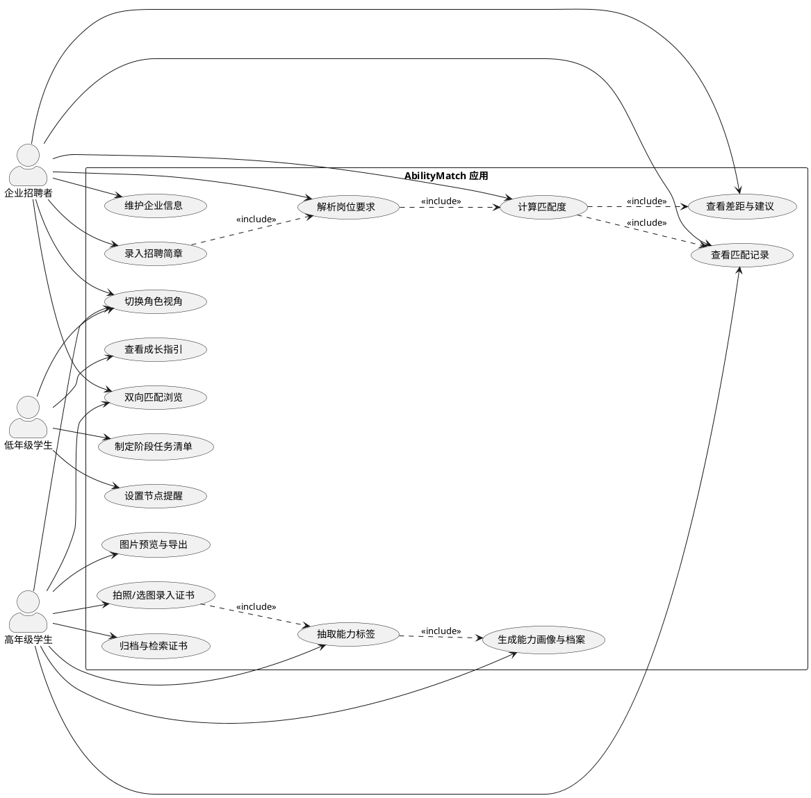
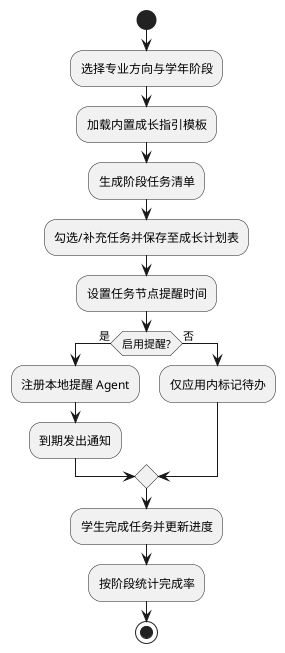
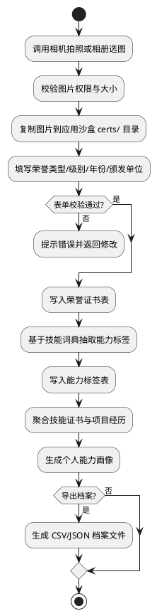
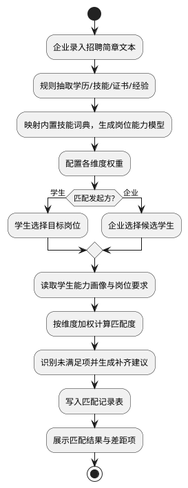
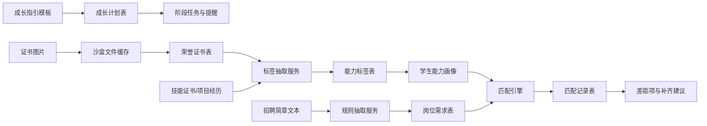

# 01 需求分析

> 适用工程：AbilityMatch
> 更新日期：2026-11-21

## 1. 项目背景与问题定义

本课题面向学生成长与就业对接中的三类实际问题：

1. **低年级学生缺少整体认知**：对专业学习路径、竞赛参与、证书考取的阶段关系不清楚，成长规划容易前松后紧。
2. **高年级学生能力材料分散**：竞赛获奖、荣誉证书、项目经历与技能证书散落在纸质奖状、邮件通知和各类评奖系统中，难以汇总为可展示的能力档案。
3. **企业招聘简章难以比对**：岗位要求以整段文本发布，学历、技能、证书、经验等条件无法快速与学生能力逐项比对。

应用基于 HarmonyOS 单机轻量化实现：不依赖后端服务器，技能词典与匹配规则内置，全部数据保存在应用本地沙盒，可由一名学生独立完成设计、开发与测试。

## 2. 用户角色

| 角色 | 典型使用者 | 核心诉求 |
| --- | --- | --- |
| 低年级学生 | 大一至大二学生 | 按专业方向和学年获得成长指引、阶段任务清单与节点提醒 |
| 高年级学生 | 大三至大四学生 / 研究生 | 录入并归档证书材料，抽取能力标签，形成可导出的能力画像与档案 |
| 企业招聘者 | HR、用人部门负责人 | 录入招聘简章，解析岗位要求，查看匹配候选人及差距项 |

> 说明：“低年级/高年级”是同一学生在专业成长不同阶段的使用视图，不是两套独立账号；应用通过 Preferences 记录当前视角，数据按 `student_id` 统一存储。

## 3. 项目目标与范围

**目标**

- 提供“专业方向 × 学年阶段”的成长指引模板与任务清单，支持节点提醒。
- 支持拍照/相册录入证书，按荣誉类型、级别、获奖年份、颁发单位归档，支持检索、筛选、预览与导出。
- 从证书、技能证书、项目经历中抽取能力标签，生成个人能力画像与可导出档案。
- 从招聘简章文本中抽取学历、技能、证书、经验要求，构建岗位能力模型。
- 按维度加权计算匹配度，输出差距项与补齐建议，实现学生查岗位、企业看候选人的双向匹配。

**范围内**

- Stage 模型 + ArkTS + ArkUI 声明式 UI。
- HarmonyOS RDB 负责结构化业务数据，Preferences 负责配置与轻量状态。
- 本地图片选择/拍照、沙盒文件缓存、图片预览。
- 内置技能词典、规则抽取与加权匹配算法。

**范围外**

- 后端服务、账号注册登录、云端同步、跨设备分布式数据同步。
- OCR 自动识别奖状文字（图片仅作附件保存，结构化信息由用户表单录入）。
- 在线投递、即时通讯、招聘信息爬虫。

## 4. 功能性需求

| 编号 | 需求名称 | 描述 | 优先级 |
| --- | --- | --- | --- |
| FR-01 | 角色视角切换 | 在“学生端/企业端”之间切换，保持各自表单与列表状态 | 高 |
| FR-02 | 成长指引 | 按专业方向、学年阶段展示学习路径、竞赛与证书建议 | 高 |
| FR-03 | 阶段任务清单 | 展示阶段任务模板，支持勾选完成、自定义补充与进度统计 | 高 |
| FR-04 | 节点提醒 | 为任务设置提醒时间，到期通过本地提醒 Agent 发出通知 | 中 |
| FR-05 | 证书录入 | 调用相机拍照或从相册选图，图片复制到应用沙盒并关联记录 | 高 |
| FR-06 | 证书归档 | 按荣誉类型、级别、获奖年份、颁发单位归档，支持增删改查 | 高 |
| FR-07 | 检索与筛选 | 关键字模糊检索，组合条件筛选，结果列表分页展示 | 高 |
| FR-08 | 图片预览与导出 | 全屏预览证书原图；导出证书记录为 CSV/JSON | 中 |
| FR-09 | 能力标签抽取 | 依据内置词典与规则，从证书、技能证书、项目经历中抽取标签 | 高 |
| FR-10 | 能力画像 | 按标签类别与熟练度展示画像雷达/标签云，统计覆盖度 | 高 |
| FR-11 | 能力档案导出 | 导出包含基本信息、证书、标签、项目经历的档案文件 | 中 |
| FR-12 | 企业信息维护 | 录入企业名称、行业、联系人等基础信息 | 中 |
| FR-13 | 招聘简章录入 | 粘贴或输入招聘简章文本，校验非空与长度 | 高 |
| FR-14 | 岗位要求抽取 | 通过内置技能词典与正则规则抽取学历、技能、证书、经验要求 | 高 |
| FR-15 | 岗位能力模型 | 将抽取结果转为结构化岗位记录，支持维度权重配置 | 高 |
| FR-16 | 匹配度计算 | 按学历、技能、证书、经验、荣誉/项目五维加权计算匹配度 | 高 |
| FR-17 | 差距与建议 | 输出未满足项，并按内置建议库给出补齐路径 | 高 |
| FR-18 | 双向匹配 | 学生浏览岗位列表与匹配分；企业浏览候选人列表与匹配分 | 高 |
| FR-19 | 匹配记录 | 保存每次匹配的时间、维度得分与差距项，支持历史查看 | 中 |

## 5. 非功能性需求

| 类别 | 指标 |
| --- | --- |
| 性能 | 1000 条证书记录下，组合筛选与关键字检索响应时间 < 1 s；匹配计算 < 200 ms |
| 容量 | 支持单人 2000 条业务记录；图片采用沙盒缓存与缩略图，避免内存峰值过高 |
| 易用性 | 表单必填项标注清晰，错误输入即时提示；常用操作不超过 3 次点击 |
| 隐私与安全 | 数据仅存本地沙盒，不上传网络；图片路径使用相对路径；导出文件由用户主动触发 |
| 兼容性 | 适配 phone / tablet / 2in1；API 12 及以上；支持深色/浅色系统主题 |
| 可维护性 | 分层架构，词典与规则以资源文件内置，便于单独更新 |
| 可测试性 | 关键算法（标签抽取、加权匹配）封装为纯函数，便于 Hypium 单元测试 |

## 6. 用例图

## 7. 核心业务流程

### 7.1 成长规划与提醒流程

### 7.2 证书录入与能力画像流程

### 7.3 招聘简章解析与双向匹配流程

## 8. 数据流说明

## 9. 需求验收对照

| 需求编号 | 验收要点 |
| --- | --- |
| FR-02/03/04 | 选择专业与学年后能展示对应任务清单；勾选状态持久化；提醒时间可保存并触发 |
| FR-05/06/07 | 拍照或选图后记录可保存；四类归档字段完整；关键字与组合条件检索结果正确 |
| FR-08 | 点击记录可全屏预览原图；导出文件可在文件管理中查看 |
| FR-09/10/11 | 录入证书后自动生成标签；画像页展示标签与统计；档案导出内容完整 |
| FR-13/14/15 | 简章文本可保存；学历、技能、证书、经验被正确抽取并展示为结构化岗位 |
| FR-16/17 | 匹配分与人工计算一致；差距项列出未满足条件并给出建议 |
| FR-18/19 | 学生端岗位列表与企业端候选人列表均显示匹配分；历史记录可回溯 |

> 实际验收状态、实现证据与差距清单见 `docs/04-需求实现对照与差距分析.md`；构建与测试结果见 `docs/05-系统测试报告.md`。FR-07 的分页展示已于 2026-11-22 实现；FR-10 的“雷达图”尚未落地，现为标签云 + 分类统计；FR-03 的“进度统计”仅以首页逾期提醒呈现。
