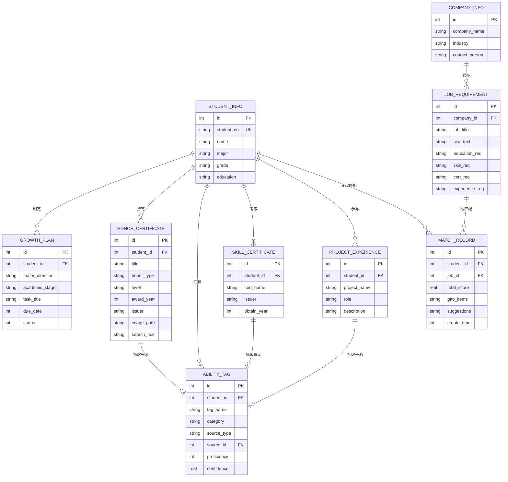

# 02 数据库设计

> 适用工程：AbilityMatch
> 更新日期：2026-11-21

## 1. 设计原则

- 使用 HarmonyOS **关系型数据库（RDB）** 保存结构化业务数据，底层基于 SQLite，数据文件位于应用沙盒。
- 使用 **Preferences** 保存轻量配置：当前角色视角、当前学生、提醒开关、默认匹配权重、筛选条件缓存、词典版本等。
- 图片以文件形式保存在 `${context.filesDir}/certs/`，数据库仅保存相对路径，避免 BLOB 膨胀。
- 所有表使用 `id INTEGER PRIMARY KEY AUTOINCREMENT`，时间字段使用 `INTEGER` 存毫秒时间戳。
- 外键通过字段约定与业务层校验维护，避免开启外键约束导致迁移复杂。
- 需要模糊检索的证书记录额外维护 `search_text` 归一化字段（小写拼接），配合索引提升检索效率。

## 2. 概念模型（ER 图）



> 其中 `skill_certificate` 与 `project_experience` 是为支撑“技能证书与项目经历形成能力画像”而设的扩展表；题目明确要求的 7 张表均已包含。
>
> 后续迭代新增 `app_meta`（结构版本与配置元数据）、`user_account`（账号与资质核验）、`honor_search_token`（荣誉倒排索引），并为 `student_info` 增加 `is_public`（公开求职档案）字段。**完整字段、索引、外键与唯一约束以 `docs/数据库表结构说明.md` 为准**。

## 3. 逻辑结构设计

### 3.1 学生信息表 `student_info`

| 字段 | 类型 | 约束 | 说明 |
| --- | --- | --- | --- |
| id | INTEGER | PK, AUTOINCREMENT | 学生主键 |
| student_no | TEXT | NOT NULL, UNIQUE | 学号 |
| name | TEXT | NOT NULL | 姓名 |
| major | TEXT | — | 专业名称 |
| grade | TEXT | — | 年级，如“大三 / 研一” |
| education | TEXT | DEFAULT '本科' | 学历：大专 / 本科 / 硕士 / 博士，用于学历要求比对 |
| direction | TEXT | — | 专业方向，如“软件开发” |
| phone | TEXT | — | 联系电话 |
| email | TEXT | — | 邮箱 |
| create_time | INTEGER | NOT NULL | 创建时间（ms） |
| update_time | INTEGER | NOT NULL | 更新时间（ms） |

### 3.2 成长计划表 `growth_plan`

| 字段 | 类型 | 约束 | 说明 |
| --- | --- | --- | --- |
| id | INTEGER | PK, AUTOINCREMENT | 计划项主键 |
| student_id | INTEGER | NOT NULL | 关联学生 |
| major_direction | TEXT | NOT NULL | 专业方向 |
| academic_stage | TEXT | NOT NULL | 学年阶段，如“大一上” |
| task_title | TEXT | NOT NULL | 任务标题 |
| task_desc | TEXT | — | 任务说明 |
| category | TEXT | — | COURSE/COMPETITION/CERT/PROJECT |
| due_date | INTEGER | — | 计划完成时间（ms） |
| status | INTEGER | DEFAULT 0 | 0 未完成，1 已完成 |
| remind_enabled | INTEGER | DEFAULT 0 | 是否启用提醒 |
| remind_time | INTEGER | — | 提醒触发时间（ms） |
| reminder_id | INTEGER | DEFAULT 0 | 系统提醒 ID，用于取消/更新提醒 |
| create_time | INTEGER | NOT NULL | 创建时间 |
| update_time | INTEGER | NOT NULL | 更新时间 |

索引：`idx_growth_student_stage(student_id, academic_stage)`、`idx_growth_due(due_date)`。

### 3.3 荣誉证书表 `honor_certificate`

| 字段 | 类型 | 约束 | 说明 |
| --- | --- | --- | --- |
| id | INTEGER | PK, AUTOINCREMENT | 证书记录主键 |
| student_id | INTEGER | NOT NULL | 关联学生 |
| title | TEXT | NOT NULL | 证书/奖项名称 |
| honor_type | TEXT | NOT NULL | 荣誉类型：COMPETITION/HONOR/CERTIFICATE |
| level | TEXT | — | 级别：NATIONAL/PROVINCIAL/UNIVERSITY/COLLEGE |
| award_year | INTEGER | — | 获奖年份 |
| issuer | TEXT | — | 颁发单位 |
| image_path | TEXT | — | 沙盒相对路径，如 `certs/169xxxx.jpg` |
| remark | TEXT | — | 备注 |
| search_text | TEXT | — | 小写归一化检索串（标题+单位+备注） |
| create_time | INTEGER | NOT NULL | 创建时间 |
| update_time | INTEGER | NOT NULL | 更新时间 |

索引：`idx_honor_student(student_id)`、`idx_honor_filter(student_id, honor_type, level, award_year)`、`idx_honor_search(search_text)`。

### 3.4 能力标签表 `ability_tag`

| 字段 | 类型 | 约束 | 说明 |
| --- | --- | --- | --- |
| id | INTEGER | PK, AUTOINCREMENT | 标签主键 |
| student_id | INTEGER | NOT NULL | 关联学生 |
| tag_name | TEXT | NOT NULL | 标签名称，如“Java”“算法竞赛” |
| category | TEXT | NOT NULL | SKILL/CERTIFICATE/HONOR/PROJECT |
| source_type | TEXT | — | 来源类型，与来源表对应 |
| source_id | INTEGER | — | 来源记录 id |
| proficiency | INTEGER | DEFAULT 3 | 熟练度 1～5 |
| confidence | REAL | DEFAULT 1.0 | 抽取置信度 0～1 |
| create_time | INTEGER | NOT NULL | 创建时间 |

唯一约束建议：`(student_id, tag_name, source_type, source_id)`，避免重复抽取。索引：`idx_tag_student(student_id)`、`idx_tag_name(tag_name)`。

### 3.5 企业信息表 `company_info`

| 字段 | 类型 | 约束 | 说明 |
| --- | --- | --- | --- |
| id | INTEGER | PK, AUTOINCREMENT | 企业主键 |
| company_name | TEXT | NOT NULL | 企业名称 |
| industry | TEXT | — | 所属行业 |
| scale | TEXT | — | 企业规模 |
| contact_person | TEXT | — | 联系人 |
| contact_phone | TEXT | — | 联系电话 |
| address | TEXT | — | 地址 |
| create_time | INTEGER | NOT NULL | 创建时间 |
| update_time | INTEGER | NOT NULL | 更新时间 |

### 3.6 岗位需求表 `job_requirement`

| 字段 | 类型 | 约束 | 说明 |
| --- | --- | --- | --- |
| id | INTEGER | PK, AUTOINCREMENT | 岗位主键 |
| company_id | INTEGER | NOT NULL | 关联企业 |
| job_title | TEXT | NOT NULL | 岗位名称 |
| raw_text | TEXT | — | 原始招聘简章文本 |
| education_req | TEXT | — | 学历要求（本科/硕士等） |
| skill_req | TEXT | — | 技能要求 JSON 数组 |
| cert_req | TEXT | — | 证书要求 JSON 数组 |
| experience_req | TEXT | — | 经验要求 JSON，如 `{"years":1,"keywords":["实习"]}` |
| weight_education | REAL | DEFAULT 0.20 | 学历权重 |
| weight_skill | REAL | DEFAULT 0.35 | 技能权重 |
| weight_cert | REAL | DEFAULT 0.20 | 证书权重 |
| weight_experience | REAL | DEFAULT 0.15 | 经验权重 |
| weight_honor | REAL | DEFAULT 0.10 | 荣誉/项目权重 |
| status | INTEGER | DEFAULT 1 | 1 有效，0 归档 |
| create_time | INTEGER | NOT NULL | 创建时间 |
| update_time | INTEGER | NOT NULL | 更新时间 |

索引：`idx_job_company(company_id, status)`。

### 3.7 匹配记录表 `match_record`

| 字段 | 类型 | 约束 | 说明 |
| --- | --- | --- | --- |
| id | INTEGER | PK, AUTOINCREMENT | 匹配记录主键 |
| student_id | INTEGER | NOT NULL | 关联学生 |
| job_id | INTEGER | NOT NULL | 关联岗位 |
| direction | INTEGER | NOT NULL | 0 学生查岗位，1 企业看候选人 |
| total_score | REAL | NOT NULL | 总匹配度 0～100 |
| edu_score | REAL | — | 学历维度得分 |
| skill_score | REAL | — | 技能维度得分 |
| cert_score | REAL | — | 证书维度得分 |
| exp_score | REAL | — | 经验维度得分 |
| honor_score | REAL | — | 荣誉/项目维度得分 |
| gap_items | TEXT | — | 差距项 JSON 数组 |
| suggestions | TEXT | — | 补齐建议 JSON 数组 |
| create_time | INTEGER | NOT NULL | 匹配时间 |

索引：`idx_match_student(student_id, create_time)`、`idx_match_job(job_id, create_time)`。

### 3.8 扩展表：技能证书 `skill_certificate`

| 字段 | 类型 | 约束 | 说明 |
| --- | --- | --- | --- |
| id | INTEGER | PK, AUTOINCREMENT | 主键 |
| student_id | INTEGER | NOT NULL | 关联学生 |
| cert_name | TEXT | NOT NULL | 证书名称 |
| issuer | TEXT | — | 颁发机构 |
| obtain_year | INTEGER | — | 获取年份 |
| level | TEXT | — | 级别 |
| image_path | TEXT | — | 沙盒相对路径 |
| create_time | INTEGER | NOT NULL | 创建时间 |

### 3.9 扩展表：项目经历 `project_experience`

| 字段 | 类型 | 约束 | 说明 |
| --- | --- | --- | --- |
| id | INTEGER | PK, AUTOINCREMENT | 主键 |
| student_id | INTEGER | NOT NULL | 关联学生 |
| project_name | TEXT | NOT NULL | 项目名称 |
| role | TEXT | — | 担任角色 |
| start_date | INTEGER | — | 开始时间 |
| end_date | INTEGER | — | 结束时间 |
| description | TEXT | — | 项目描述 |
| tags | TEXT | — | 项目技能标签 JSON 数组 |
| create_time | INTEGER | NOT NULL | 创建时间 |

## 4. 建表语句（RDB 初始化脚本）

```sql
CREATE TABLE IF NOT EXISTS student_info (
  id INTEGER PRIMARY KEY AUTOINCREMENT,
  student_no TEXT NOT NULL UNIQUE,
  name TEXT NOT NULL,
  major TEXT,
  grade TEXT,
  education TEXT DEFAULT '本科',
  direction TEXT,
  phone TEXT,
  email TEXT,
  create_time INTEGER NOT NULL,
  update_time INTEGER NOT NULL
);

CREATE TABLE IF NOT EXISTS growth_plan (
  id INTEGER PRIMARY KEY AUTOINCREMENT,
  student_id INTEGER NOT NULL,
  major_direction TEXT NOT NULL,
  academic_stage TEXT NOT NULL,
  task_title TEXT NOT NULL,
  task_desc TEXT,
  category TEXT,
  due_date INTEGER,
  status INTEGER DEFAULT 0,
  remind_enabled INTEGER DEFAULT 0,
  remind_time INTEGER,
  reminder_id INTEGER DEFAULT 0,
  create_time INTEGER NOT NULL,
  update_time INTEGER NOT NULL
);
CREATE INDEX IF NOT EXISTS idx_growth_student_stage ON growth_plan(student_id, academic_stage);
CREATE INDEX IF NOT EXISTS idx_growth_due ON growth_plan(due_date);

CREATE TABLE IF NOT EXISTS honor_certificate (
  id INTEGER PRIMARY KEY AUTOINCREMENT,
  student_id INTEGER NOT NULL,
  title TEXT NOT NULL,
  honor_type TEXT NOT NULL,
  level TEXT,
  award_year INTEGER,
  issuer TEXT,
  image_path TEXT,
  remark TEXT,
  search_text TEXT,
  create_time INTEGER NOT NULL,
  update_time INTEGER NOT NULL
);
CREATE INDEX IF NOT EXISTS idx_honor_student ON honor_certificate(student_id);
CREATE INDEX IF NOT EXISTS idx_honor_filter ON honor_certificate(student_id, honor_type, level, award_year);
CREATE INDEX IF NOT EXISTS idx_honor_search ON honor_certificate(search_text);

CREATE TABLE IF NOT EXISTS ability_tag (
  id INTEGER PRIMARY KEY AUTOINCREMENT,
  student_id INTEGER NOT NULL,
  tag_name TEXT NOT NULL,
  category TEXT NOT NULL,
  source_type TEXT,
  source_id INTEGER,
  proficiency INTEGER DEFAULT 3,
  confidence REAL DEFAULT 1.0,
  create_time INTEGER NOT NULL
);
CREATE INDEX IF NOT EXISTS idx_tag_student ON ability_tag(student_id);
CREATE INDEX IF NOT EXISTS idx_tag_name ON ability_tag(tag_name);

CREATE TABLE IF NOT EXISTS company_info (
  id INTEGER PRIMARY KEY AUTOINCREMENT,
  company_name TEXT NOT NULL,
  industry TEXT,
  scale TEXT,
  contact_person TEXT,
  contact_phone TEXT,
  address TEXT,
  create_time INTEGER NOT NULL,
  update_time INTEGER NOT NULL
);

CREATE TABLE IF NOT EXISTS job_requirement (
  id INTEGER PRIMARY KEY AUTOINCREMENT,
  company_id INTEGER NOT NULL,
  job_title TEXT NOT NULL,
  raw_text TEXT,
  education_req TEXT,
  skill_req TEXT,
  cert_req TEXT,
  experience_req TEXT,
  weight_education REAL DEFAULT 0.20,
  weight_skill REAL DEFAULT 0.35,
  weight_cert REAL DEFAULT 0.20,
  weight_experience REAL DEFAULT 0.15,
  weight_honor REAL DEFAULT 0.10,
  status INTEGER DEFAULT 1,
  create_time INTEGER NOT NULL,
  update_time INTEGER NOT NULL
);
CREATE INDEX IF NOT EXISTS idx_job_company ON job_requirement(company_id, status);

CREATE TABLE IF NOT EXISTS match_record (
  id INTEGER PRIMARY KEY AUTOINCREMENT,
  student_id INTEGER NOT NULL,
  job_id INTEGER NOT NULL,
  direction INTEGER NOT NULL,
  total_score REAL NOT NULL,
  edu_score REAL,
  skill_score REAL,
  cert_score REAL,
  exp_score REAL,
  honor_score REAL,
  gap_items TEXT,
  suggestions TEXT,
  create_time INTEGER NOT NULL
);
CREATE INDEX IF NOT EXISTS idx_match_student ON match_record(student_id, create_time);
CREATE INDEX IF NOT EXISTS idx_match_job ON match_record(job_id, create_time);

CREATE TABLE IF NOT EXISTS skill_certificate (
  id INTEGER PRIMARY KEY AUTOINCREMENT,
  student_id INTEGER NOT NULL,
  cert_name TEXT NOT NULL,
  issuer TEXT,
  obtain_year INTEGER,
  level TEXT,
  image_path TEXT,
  create_time INTEGER NOT NULL
);
CREATE INDEX IF NOT EXISTS idx_skill_cert_student ON skill_certificate(student_id);

CREATE TABLE IF NOT EXISTS project_experience (
  id INTEGER PRIMARY KEY AUTOINCREMENT,
  student_id INTEGER NOT NULL,
  project_name TEXT NOT NULL,
  role TEXT,
  start_date INTEGER,
  end_date INTEGER,
  description TEXT,
  tags TEXT,
  create_time INTEGER NOT NULL
);
CREATE INDEX IF NOT EXISTS idx_project_student ON project_experience(student_id);
```

## 5. Preferences 键设计

| 键名 | 类型 | 默认值 | 说明 |
| --- | --- | --- | --- |
| `current_role` | string | `student` | 当前角色视角 |
| `current_student_id` | number | `1` | 当前学生记录 id |
| `remind_enabled` | boolean | `true` | 全局提醒开关 |
| `weight_education` | number | `0.20` | 默认学历权重 |
| `weight_skill` | number | `0.35` | 默认技能权重 |
| `weight_cert` | number | `0.20` | 默认证书权重 |
| `weight_experience` | number | `0.15` | 默认经验权重 |
| `weight_honor` | number | `0.10` | 默认荣誉/项目权重 |
| `honor_filter_cache` | string | `{}` | 上次筛选条件 JSON |
| `skill_dict_version` | string | `1.0.0` | 内置词典版本，用于升级提示 |
| `db_version` | number | `1` | 数据库结构版本 |

## 6. 检索与索引优化策略

1. **组合筛选走复合索引**：证书列表固定以 `student_id` 为前置条件，`idx_honor_filter(student_id, honor_type, level, award_year)` 可覆盖主要筛选组合。
2. **关键字检索使用归一化字段**：录入时把标题、颁发单位、备注拼接为小写写入 `search_text`；查询时统一转小写后使用 `LIKE 'keyword%'`。避免对原字段使用 `%keyword%` 前置通配导致索引失效。
3. **分页加载**：列表查询统一带 `LIMIT ? OFFSET ?`，避免一次性载入上千条记录。
4. **标签写入**：当前按条写入 `ability_tag`（`DbHelper.insert`），数据规模为单机轻量场景；后续可在批量导入时改为事务。
5. **图片不入库**：数据库仅保存相对路径；删除证书、替换图片、取消未保存的新图时会同步清理沙盒文件，当前不生成独立缩略图，预览直接加载原图。
6. **版本迁移**：`EntryAbility` 在 RDB/Preferences 初始化完成后写入 `db_version`；`DbHelper.migrate()` 兼容旧库补加 `growth_plan.reminder_id` 与 `student_info.education` 列。
