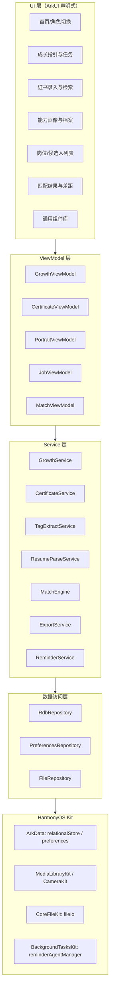
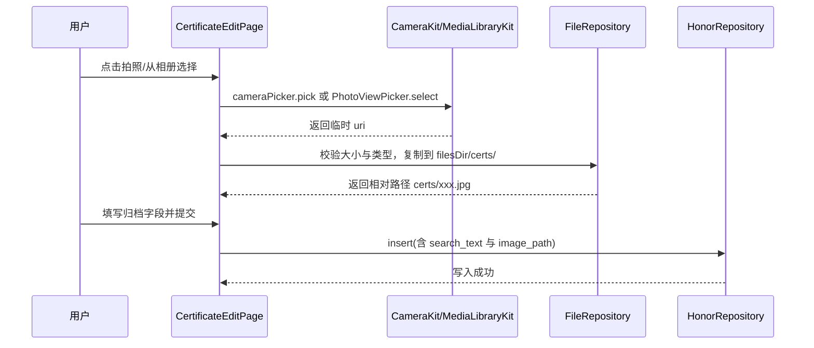

# 03 系统架构与接口设计

> 适用工程：AbilityMatch
> 更新日期：2026-11-21

## 1. 架构总览

系统采用分层架构，UI 只负责展示与交互，业务规则集中在 Service 层，数据访问统一通过 Repository 层，便于单机轻量化实现与单元测试。



## 2. 工程目录规划

```text
entry/src/main/
├── module.json5
├── ets/
│   ├── entryability/EntryAbility.ets
│   ├── pages/
│   │   ├── Index.ets                    # 首页与角色切换
│   │   ├── GrowthGuidePage.ets          # 成长指引与任务清单
│   │   ├── CertificatePage.ets          # 证书列表/检索/筛选
│   │   ├── CertificateEditPage.ets      # 拍照录入与表单
│   │   ├── PortraitPage.ets             # 能力画像
│   │   ├── JobListPage.ets              # 学生查岗位
│   │   ├── JobDetailPage.ets            # 岗位详情与匹配结果
│   │   ├── CompanyPage.ets              # 企业信息
│   │   ├── JobPublishPage.ets           # 招聘简章录入与解析
│   │   ├── CandidatePage.ets            # 企业看候选人
│   │   ├── CandidateDetailPage.ets      # 候选人匹配详情
│   │   └── MatchRecordPage.ets          # 匹配历史
│   ├── model/
│   │   ├── Entity.ets                   # 数据实体
│   │   └── Enums.ets                    # 枚举与常量
│   ├── common/
│   │   ├── Constants.ets                # 表名、权重、建表 SQL
│   │   ├── DbHelper.ets                 # RDB 初始化、CRUD 与查询封装
│   │   ├── PrefsHelper.ets              # Preferences 封装
│   │   ├── FileHelper.ets               # 沙盒路径与图片缓存
│   │   ├── ResourceHelper.ets           # rawfile 词典/模板/建议库加载
│   │   ├── RouteHelper.ets              # 路由参数空值安全处理
│   │   └── Logger.ets                   # hilog 封装
│   ├── service/
│   │   ├── GrowthService.ets
│   │   ├── CertificateService.ets
│   │   ├── TagExtractService.ets
│   │   ├── ResumeParseService.ets
│   │   ├── MatchEngine.ets
│   │   ├── ExportService.ets
│   │   └── ReminderService.ets
│   ├── repository/
│   │   ├── BaseRepository.ets           # 类型转换工具
│   │   ├── StudentRepository.ets
│   │   ├── GrowthRepository.ets
│   │   ├── HonorRepository.ets
│   │   ├── TagRepository.ets
│   │   ├── CompanyRepository.ets
│   │   ├── JobRepository.ets
│   │   ├── MatchRepository.ets
│   │   ├── ProfileRepository.ets        # 技能证书与项目经历
│   │   └── Repositories.ets             # 单例导出
│   ├── viewmodel/
│   │   └── AppViewModel.ets             # 当前角色/学生共享状态
│   └── view/
│       ├── CertificateCard.ets
│       ├── TagChip.ets
│       ├── ScoreBar.ets
│       └── EmptyState.ets
└── resources/
    ├── base/profile/main_pages.json     # 注册全部页面路由
    └── rawfile/
        ├── skill_dict.json              # 内置技能词典与同义词
        ├── growth_templates.json        # 专业×学年成长模板
        └── advice_lib.json              # 补齐建议库
```

测试代码位于 `entry/src/test/ets/`：`ResumeParseService.test.ets`、`MatchEngine.test.ets`，由 `entry/src/test/List.test.ets` 统一注册。

> 以上页面均已在 `main_pages.json` 中注册，应用骨架与核心业务功能已实现完成。

## 3. 页面路由设计

| 页面 | 路由路径 | 主要参数 | 功能 |
| --- | --- | --- | --- |
| 首页 | `pages/Index` | — | 角色切换、功能入口、当前学生概览、过期任务提示 |
| 学生资料 | `pages/StudentEditPage` | `studentId` | 新增、编辑与切换学生档案（含学历字段） |
| 成长指引 | `pages/GrowthGuidePage` | `studentId` | 专业方向/学年选择、任务清单、提醒设置 |
| 证书列表 | `pages/CertificatePage` | `studentId` | 关键字检索、条件筛选、分页、预览、导出 |
| 证书编辑 | `pages/CertificateEditPage` | `studentId`, `certId` | 拍照/选图、表单录入与校验 |
| 能力画像 | `pages/PortraitPage` | `studentId` | 标签云、维度统计、档案导出 |
| 岗位列表 | `pages/JobListPage` | `studentId` | 学生浏览岗位及匹配分 |
| 岗位详情 | `pages/JobDetailPage` | `jobId`, `studentId` | 要求解析结果、匹配详情、差距与建议 |
| 企业信息 | `pages/CompanyPage` | `companyId` | 企业基础信息维护 |
| 招聘发布 | `pages/JobPublishPage` | `companyId` | 简章录入、解析预览、权重配置、保存 |
| 候选人列表 | `pages/CandidatePage` | 无 | 按企业筛选岗位，查看候选人及匹配分 |
| 候选人详情 | `pages/CandidateDetailPage` | `jobId`, `studentId` | 五维得分、差距、建议与能力标签 |
| 匹配记录 | `pages/MatchRecordPage` | `studentId` / `jobId` | 历史匹配分与差距项回溯 |

## 4. 核心数据接口

```ts
export interface Student {
  id: number;
  studentNo: string;
  name: string;
  major: string;
  grade: string;
  education: string;  // 大专 / 本科 / 硕士 / 博士
  direction: string;
  phone?: string;
  email?: string;
}

export interface HonorCertificate {
  id: number;
  studentId: number;
  title: string;
  honorType: 'COMPETITION' | 'HONOR' | 'CERTIFICATE';
  level?: 'NATIONAL' | 'PROVINCIAL' | 'UNIVERSITY' | 'COLLEGE';
  awardYear?: number;
  issuer?: string;
  imagePath?: string;
  remark?: string;
  createTime: number;
}

export interface AbilityTag {
  id: number;
  studentId: number;
  tagName: string;
  category: 'SKILL' | 'CERTIFICATE' | 'HONOR' | 'PROJECT';
  sourceType?: string;
  sourceId?: number;
  proficiency: number;   // 1~5
  confidence: number;    // 0~1
}

export interface JobRequirement {
  id: number;
  companyId: number;
  jobTitle: string;
  rawText: string;
  educationReq?: string;
  skillReq: string[];
  certReq: string[];
  experienceYears: number;
  weights: MatchWeights;
}

export interface MatchWeights {
  education: number;
  skill: number;
  certificate: number;
  experience: number;
  honor: number;
}

export interface MatchResult {
  totalScore: number;
  dimensionScores: {
    education: number;
    skill: number;
    certificate: number;
    experience: number;
    honor: number;
  };
  gapItems: string[];
  suggestions: string[];
}
```

### 4.1 Repository 接口示例

```ts
export interface HonorRepository {
  insert(cert: HonorCertificate): Promise<number>;
  update(cert: HonorCertificate): Promise<void>;
  deleteById(id: number): Promise<void>;
  queryByFilter(studentId: number, filter: HonorFilter,
                 limit: number, offset: number): Promise<HonorCertificate[]>;
  countByFilter(studentId: number, filter: HonorFilter): Promise<number>;
}

export interface MatchRepository {
  insert(record: MatchRecord): Promise<number>;
  queryByStudent(studentId: number): Promise<MatchRecord[]>;
  queryByJob(jobId: number): Promise<MatchRecord[]>;
}
```

## 5. 关键服务设计

### 5.1 数据库初始化

- 使用 `relationalStore.getRdbStore(context, config)` 获取 `RdbStore`，配置中指定数据库文件名 `AbilityMatch.db` 与安全级别 `S1`。
- 在 `DbHelper.init()` 中执行第 2 章的全部建表语句；`EntryAbility` 在 RDB 与 Preferences 均初始化完成后写入 `db_version`。
- 所有 Repository 共享同一个 `RdbStore` 单例，避免多连接造成锁竞争。
- 查询统一通过 `DbHelper` 的参数化 SQL 封装完成，写入使用 `ValuesBucket`。

### 5.2 图片录入与缓存



- 相册选择使用 `photoAccessHelper.PhotoViewPicker`，拍照使用 `cameraPicker.pick`。
- 图片统一复制到 `${context.filesDir}/certs/`，文件名使用时间戳+随机数；数据库仅保存相对路径。
- 预览时由相对路径拼接绝对路径，通过 `Image` 组件直接加载原图；当前不单独生成 320px 缩略图。
- 删除证书记录、替换图片、取消未保存的新图时会清理对应的沙盒文件；当前不执行启动时的全量孤儿文件扫描。

### 5.3 内置技能词典结构

`resources/rawfile/skill_dict.json` 示例：

```json
{
  "version": "1.0.0",
  "skills": [
    { "name": "Java", "aliases": ["JAVA", "Java语言", "Java SE"], "category": "PROGRAMMING" },
    { "name": "HarmonyOS", "aliases": ["鸿蒙", "ArkTS", "ArkUI", "HarmonyOS NEXT"], "category": "PLATFORM" },
    { "name": "MySQL", "aliases": ["数据库", "SQL", "关系型数据库"], "category": "DATA" },
    { "name": "算法", "aliases": ["数据结构", "ACM", "算法竞赛"], "category": "FOUNDATION" }
  ],
  "certificates": [
    { "name": "CET-6", "aliases": ["大学英语六级", "六级"] },
    { "name": "计算机二级", "aliases": ["全国计算机等级考试二级"] },
    { "name": "软考中级", "aliases": ["软件设计师", "系统集成项目管理工程师"] }
  ],
  "educationRank": ["大专", "本科", "硕士", "博士"]
}
```

### 5.4 招聘文本规则抽取

1. **学历**：按 `educationRank` 从高到低匹配；出现多个要求取最高。正则示例：`(博士|硕士|研究生|本科|大专|专科)`。
2. **技能**：遍历 `skills` 与 `aliases`，做大小写归一化后包含匹配，命中即映射为标准技能名并去重。
3. **证书**：遍历 `certificates` 与别名匹配，命中写入 `cert_req`。
4. **经验**：正则 `(\d+)\\s*年` 提取最低年限；同时识别“应届生/实习/项目经验”等关键词作为经验描述。
5. **权重**：默认使用 Preferences 中的五个权重，用户可在招聘发布页微调并归一化到总和 1。

抽取结果为纯函数 `parseResumeText(text: string, dict: SkillDict): ParsedRequirement`，便于单元测试。

### 5.5 多维加权匹配算法

**维度得分定义**（均归一化到 0～1）：

- 学历 \(s_{edu}\)：学生学历等级序号 ≥ 要求序号取 1；低一级取 0.6；低两级及以上取 0。
- 技能 \(s_{skill}\)：\(\frac{|\text{学生技能} \cap \text{岗位技能}|}{|\text{岗位技能}|}\)，无技能要求时取 1。
- 证书 \(s_{cert}\)：\(\frac{|\text{学生证书} \cap \text{岗位证书}|}{|\text{岗位证书}|}\)，无证书要求时取 1。
- 经验 \(s_{exp}\)：\(\min(\frac{\text{学生项目/实习年限}}{\text{要求年限}}, 1)\)，无经验要求时取 1。
- 荣誉/项目 \(s_{honor}\)：按国家级/省级/校级荣誉与项目数量折算，上限 1。

**总分**：

\[
Score = 100 \times \sum_{i} w_i \cdot s_i, \quad \sum_i w_i = 1
\]

默认权重：学历 0.20、技能 0.35、证书 0.20、经验 0.15、荣誉/项目 0.10。

**示例**：某岗位要求本科、Java、HarmonyOS、CET-6、1 年经验；学生为本科学历、具备 Java 与 HarmonyOS 标签、无 CET-6、0.5 年项目经验、有省级竞赛奖。

\[
\begin{aligned}
s_{edu}&=1, & s_{skill}&=2/2=1, & s_{cert}&=0/1=0,\\
s_{exp}&&=0.5/1=0.5, & s_{honor}&=0.8\\
Score &=100\times(0.20\times1+0.35\times1+0.20\times0+0.15\times0.5+0.10\times0.8)=77.5
\end{aligned}
\]

**差距项与建议**：对未满足的技能、证书、经验逐项生成 `gapItems`；按标签从 `advice_lib.json` 查找建议，例如“CET-6”对应“建议在大三上学期前完成六级备考并报名”。

**双向匹配**：学生查岗位时遍历有效岗位计算匹配分并降序；企业看候选人时遍历学生画像计算同一岗位匹配分并降序。两种方向均写入 `match_record.direction`。

### 5.6 导出服务

- 证书记录与能力档案均支持导出 `CSV` 与 `JSON`；CSV 字段使用逗号分隔并对含逗号文本加双引号，类型/级别写中文标签。
- 导出时通过 `picker.DocumentViewPicker.save()` 让用户选择保存位置，再写入返回的文档 URI；取消选择时不落盘。
- 沙盒内仍保留 `FileHelper.exportFile()` 作为兼容接口；导出内容包含学生基本信息、证书列表、技能证书、项目经历、能力标签与画像统计。

### 5.7 提醒服务

- `GrowthService` 在保存任务时读取 `remind_enabled` 与 `remind_time`。
- 启用时通过 `reminderAgentManager` 注册本地提醒，返回的 `reminderId` 写入 `growth_plan.reminder_id`。
- 关闭提醒或重新设置时间时，先按已保存的 `reminderId` 调用 `cancelReminder`，再注册新提醒，避免残留与重复。
- 提醒内容包含任务标题与阶段名称；应用冷启动或首页 `aboutToAppear` 时会统计已过期的未完成任务并在首页提示。

## 6. 表单校验规则

| 表单 | 字段 | 规则 |
| --- | --- | --- |
| 学生信息 | 学号、姓名 | 必填；学号唯一 |
| 证书录入 | 标题、荣誉类型 | 必填；年份范围 2000～当前年份；图片大小 ≤ 10 MB |
| 企业信息 | 企业名称 | 必填，长度 2～50 |
| 招聘简章 | 简章文本 | 必填，长度 20～10000；解析结果至少命中一个维度 |
| 权重配置 | 五个权重 | 均为 0～1，保存前归一化为总和 1 |

## 7. 测试方案

| 层级 | 测试对象 | 方法与示例 |
| --- | --- | --- |
| 单元测试 | `ResumeParseService`、`MatchEngine`、`TagExtractService` | Hypium 断言：给定样例文本返回预期学历/技能/证书/年限；回归覆盖“毕业年份误判”“中文年限”“博士研究生学历”；给定画像与岗位返回预期分数 |
| 数据层测试 | Repository 增删改查、筛选与分页 | 构造 100 条记录，验证组合筛选与分页结果正确 |
| 集成测试 | 拍照→存档→标签→画像→匹配 | 端到端验证跨服务数据流与数据库一致性 |
| UI 测试 | 页面跳转、表单校验、空状态、列表刷新 | 模拟器手工/自动化点击，检查提示与状态恢复 |
| 性能测试 | 1000 条证书检索、50 个岗位×20 名学生匹配 | 记录耗时，验证满足第 1 章指标 |
| 兼容性测试 | phone / tablet / 2in1，深浅主题 | 检查布局自适应与资源引用 |

> 主题实现：视觉主色为清新青蓝，浅桃色用于强调与点缀；所有页面颜色统一引用 `base/element/color.json` 与 `dark/element/color.json` 中的语义资源，系统切换深色模式时自动生效。卡片采用大圆角与轻柔阴影，标签为活泼描边胶囊，匹配分以浅桃色徽标突出。布局使用 `layoutWeight`、`width('100%')` 与 `Scroll`，在 phone/tablet/2in1 上按可用宽度伸缩；当前未针对宽屏做专门的多栏分栏布局。

单元测试示例：

```ts
import { describe, it, expect } from '@ohos/hypium';
import { parseResumeText } from '../main/ets/service/ResumeParseService';

describe('ResumeParseService', () => {
  it('should extract education, skills and experience', () => {
    const result = parseResumeText(
      '岗位要求：本科及以上学历，熟悉 Java、HarmonyOS，CET-6 优先，1 年以上开发经验。',
      mockDict
    );
    expect(result.educationReq).assertEqual('本科');
    expect(result.skillReq.includes('Java')).assertTrue();
    expect(result.certReq.includes('CET-6')).assertTrue();
    expect(result.experienceYears).assertEqual(1);
  });
});
```

## 8. 毕业设计论文结构建议

1. 绪论：研究背景、国内外现状、研究内容、论文组织结构。
2. 相关技术：HarmonyOS Stage 模型、ArkTS/ArkUI、RDB 与 Preferences、本地文件与提醒能力。
3. 需求分析：用户角色、功能需求、非功能需求、用例图与业务流程图。
4. 系统设计：总体架构、功能模块、数据库设计（ER 图与表结构）、匹配算法设计。
5. 系统实现：环境搭建、目录结构、关键功能实现（图片录入、标签抽取、简章解析、加权匹配、导出与提醒）。
6. 系统测试：测试环境、功能测试、算法准确性测试、性能与兼容性测试、测试结果分析。
7. 总结与展望：工作总结、不足与改进方向。
8. 参考文献、致谢、附录（核心代码与数据表字典）。
