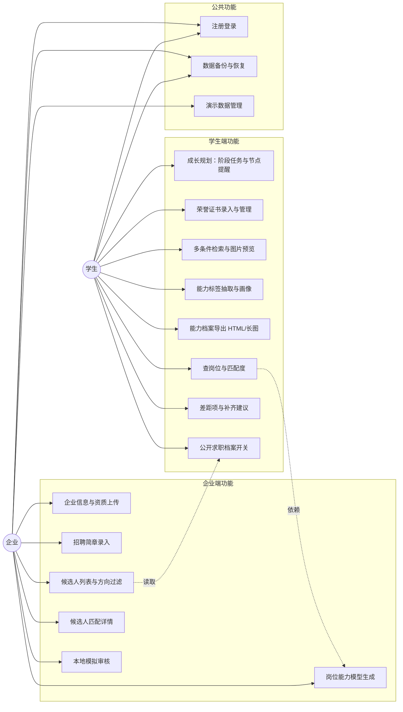
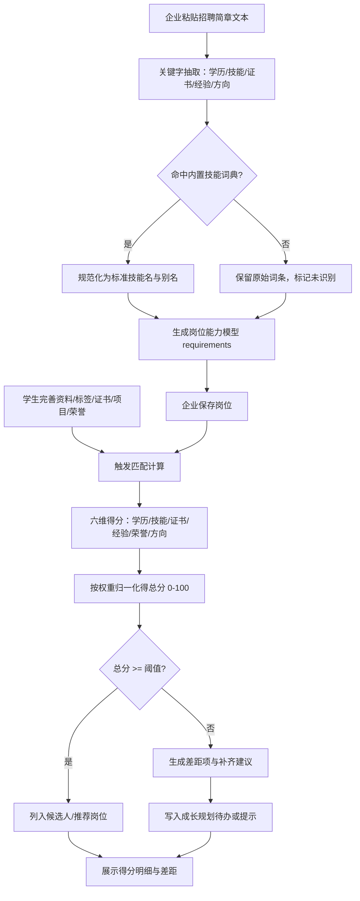
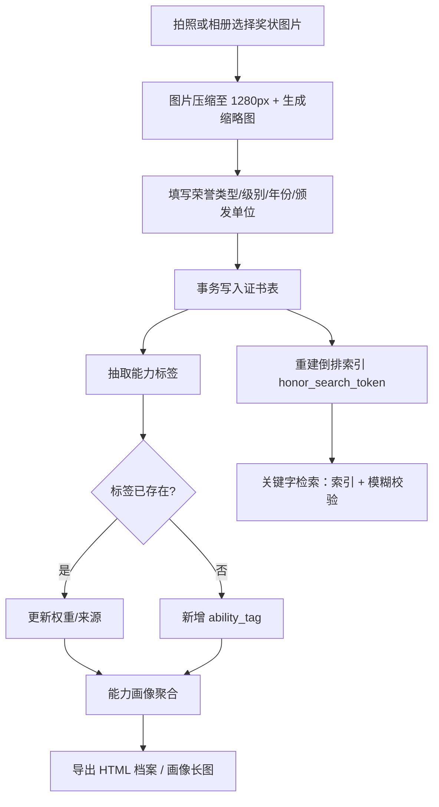
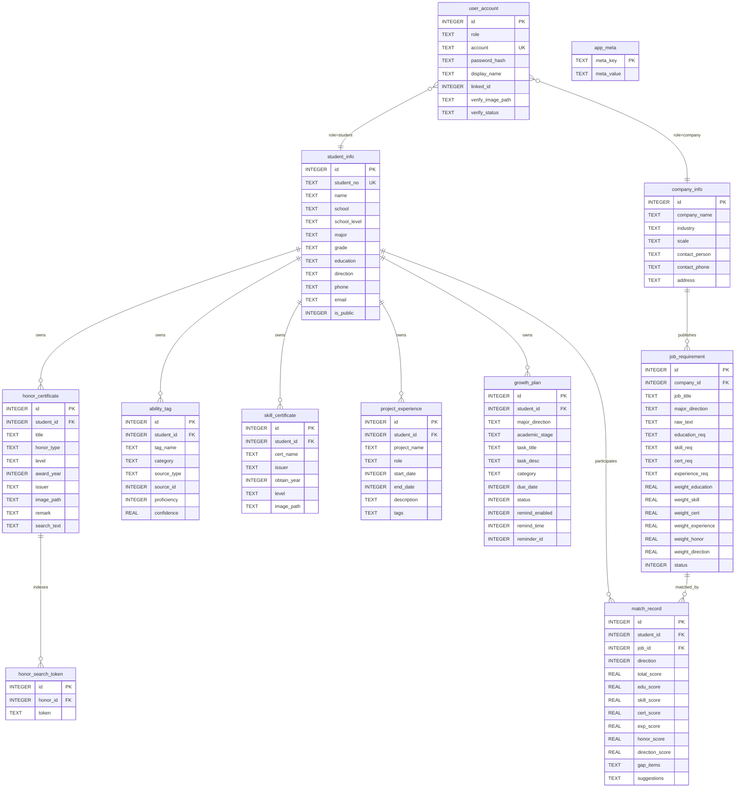

# 论文素材：用例图、业务流程图、ER 图

> 以下图使用 Mermaid 描述，可在 Typora / VS Code（Mermaid 插件）/ mermaid.live 中渲染后导出为论文插图。

## 1. 系统用例图

## 2. 业务流程图：简章录入 → 岗位模型 → 匹配 → 建议

## 3. 业务流程图：荣誉证书归档与能力标签抽取

## 4. ER 图

## 5. 匹配算法说明（论文用）

设岗位六维权重为 \(w_e, w_s, w_c, w_x, w_h, w_d\)（默认 0.15/0.30/0.15/0.15/0.10/0.15），维度达成度为 \(d_i \in [0,1]\)，则

\[
S = 100 \times \frac{\sum_i d_i \cdot w_i}{\sum_i w_i}
\]

各维度计算要点：

| 维度 | 计算方式 |
| --- | --- |
| 学历 | `Taxonomy.educationRank` 将专科/本科/硕士/博士映射为序数值；学生学历 ≥ 岗位要求得 1.0，低一档按差值衰减；学校层级（985/211/普通本科）作为附加分，仅在达标后加分，避免“学历达标但层级低”被误判为差距 |
| 技能 | 命中技能数 / 岗位要求技能数，支持词典别名归一化 |
| 证书 | 命中证书要求数 / 要求数，未要求证书时按荣誉等级折算 |
| 经验 | `experienceYears` 与项目/实习条数、年限比较，超出要求封顶 1.0 |
| 荣誉 | 依据最高荣誉级别与数量折算 |
| 方向 | `Taxonomy.directionScore`：完全一致 1.0，相邻方向 0.7，跨方向 0.3 |

差距项判定阈值：任一维度达成度 < 0.6 记入差距项并生成补齐建议；学历维度仅在 < 0.8 时提示（因学校层级加分不足导致的 0.8-1.0 不视为差距）。
